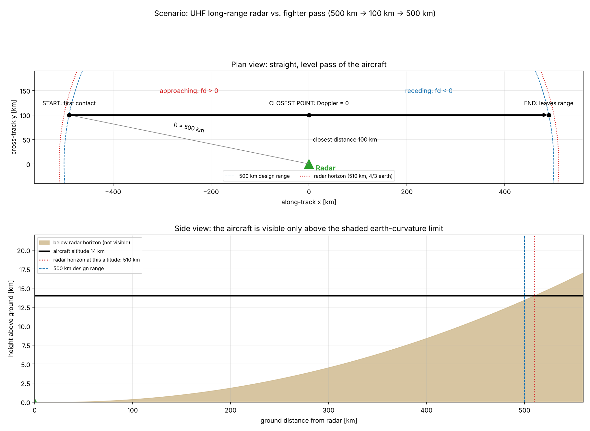
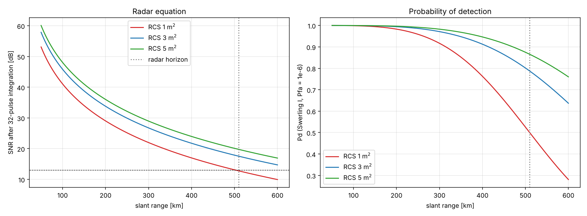
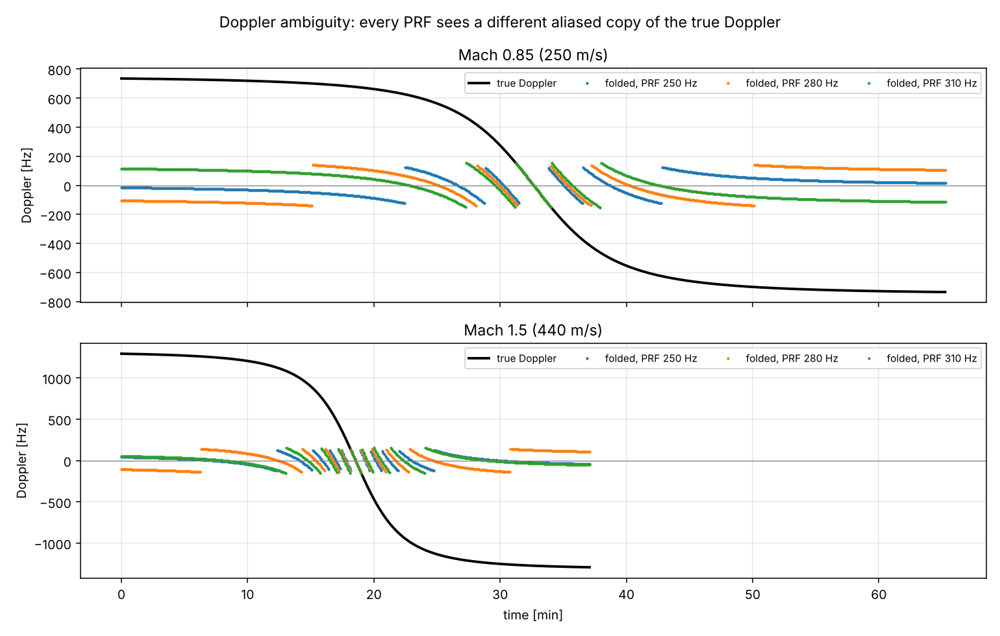
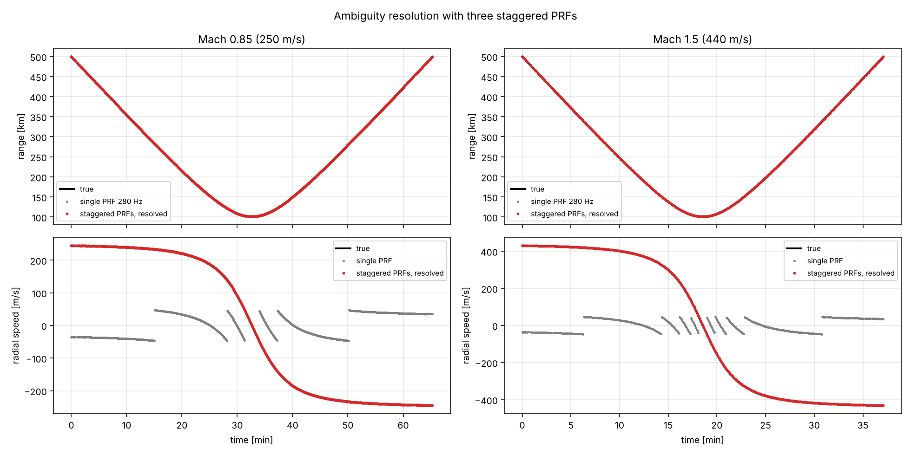
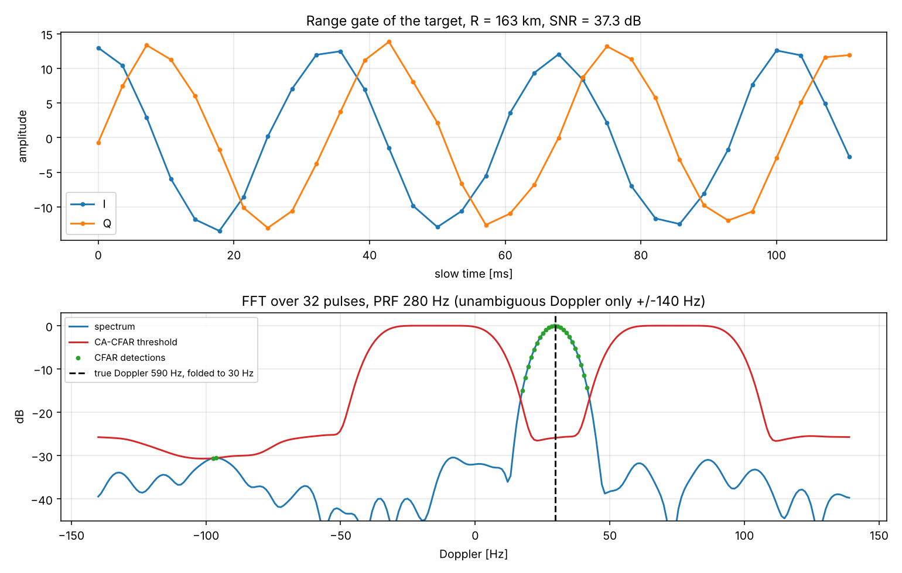

# Long-range pulse-Doppler radar vs. a fighter-class aircraft

Simulation of a UHF surveillance radar tracking a fighter-class aircraft (F/A-18-like) on a straight,
level pass: first contact at **500 km**, closest ground distance **100 km**, then it leaves again.
Two speeds are simulated, Mach 0.85 (250 m/s) and Mach 1.5 (440 m/s), at 14 km altitude.

The focus is the classic long-range problem: with a PRF low enough to avoid range ambiguity
(≤ 300 Hz for 500 km), the Doppler of a fast target is heavily aliased. The project shows the problem
and solves it with **staggered PRFs**.

Everything below is generic textbook radar theory with assumed parameters; no data of any real system
is used. The formulas implemented in the code are the ones written out in this document.



---

## 1. Notation and parameters

| Symbol | Meaning | Value used |
|---|---|---|
| $c$ | speed of light | $3\times10^{8}$ m/s |
| $k_B$ | Boltzmann constant | $1.380649\times10^{-23}$ J/K |
| $f_0$ | carrier frequency | 450 MHz (UHF) |
| $\lambda = c/f_0$ | wavelength | 0.667 m |
| $P_t$ | peak transmit power | 90 kW |
| $G$ | antenna gain (same Tx/Rx) | 28 dBi = 631 |
| $\tau$ | pulse length | 100 µs |
| $B$ | chirp bandwidth | 1 MHz |
| $F$ | receiver noise figure | 3 dB |
| $L$ | system losses | 4 dB |
| $T_0$ | reference temperature | 290 K |
| $\mathrm{PRF}_i$ | the three staggered PRFs | 250, 280, 310 Hz |
| $N$ | pulses coherently integrated per CPI | 32 |
| $P_{fa}$ | false-alarm probability per cell | $10^{-6}$ |
| $h_r$ | antenna height | 30 m |
| $h_t$ | target altitude | 14 km |
| $d_{CPA}$ | closest ground distance | 100 km |
| $R_0$ | slant range at first contact | 500 km |
| $\sigma$ | target radar cross-section | 3 m² (1 and 5 also plotted) |
| $v$ | target ground speed | 250 and 440 m/s |

---

## 2. Geometry and kinematics

The aircraft flies straight and level at altitude $h_t$, passing the radar at a horizontal
distance $d_{CPA}$. Place the radar at the origin and let $x$ be the along-track coordinate,
zero at the closest point of approach (CPA).

Starting position, from the requirement that the first contact happens at slant range $R_0$:

$$x_0 = \sqrt{R_0^2 - d_{CPA}^2 - h_t^2}$$

$$x(t) = -x_0 + v*t$$

The **slant range** (what the radar measures) and the **ground range** (what the horizon test needs) are

$$R(t) = \sqrt{x(t)^2 + d_{CPA}^2 + h_t^2} \qquad\qquad R_g(t) = \sqrt{x(t)^2 + d_{CPA}^2}$$

The **radial speed** is the rate of closing, defined positive when approaching:

$$v_r(t) = -\frac{dR}{dt} = -\frac{x(t)*v}{R(t)}$$

This is the key quantity of the whole scenario. It equals $+v$ far out on the inbound leg
($x \to -x_0$, $R \to |x|$), passes through **exactly zero at the CPA** ($x = 0$), and tends
to $-v$ on the outbound leg. A target crossing the beam at CPA is radially stationary and is
indistinguishable from clutter by Doppler alone — the classic tangential blind zone.

With $R_0 = 500$ km, $d_{CPA}=100$ km and $h_t = 14$ km, $x_0 \approx 489.7$ km, so the pass lasts
$2x_0/v \approx 65$ min at 250 m/s and $\approx 37$ min at 440 m/s.

---

## 3. Doppler shift

For a monostatic radar the signal travels to the target and back, so the path length changes at
$2v_r$ and the Doppler shift is **twice** the one-way value:

$$f_d = \frac{2 v_r}{\lambda} = \frac{2 v_r f_0}{c}$$

and inverting, the radial speed recovered from a measured Doppler is

$$v_r = \frac{\lambda f_d}{2}$$

At 450 MHz, 250 m/s gives $f_d = 750$ Hz and 440 m/s gives $f_d = 1320$ Hz. Both are far above the
PRFs used, which is exactly the problem addressed in §7–§9.

---

## 4. Radar equation

The power density at the target at range $R$ from an antenna of gain $G$ is $P_t G / (4\pi R^2)$.
The target re-radiates an equivalent power $\sigma$ times that density, which spreads again over
$4\pi R^2$, and the receiving antenna presents an effective aperture $A_e = G\lambda^2/(4\pi)$.
Multiplying the three factors gives the received power

$$P_r = \frac{P_t G^2 \lambda^2 \sigma}{(4\pi)^3 R^4}$$

The noise power in a matched receiver of bandwidth $B_n$ is $N = k_B T_0 F B_n$. For a matched
filter, $B_n \simeq 1/\tau$, so the single-pulse signal-to-noise ratio after pulse compression,
including system losses $L$, is

$$\boxed{\ \mathrm{SNR}_1(R) = \frac{P_t G^2\\lambda^2\\sigma\tau}{(4\pi)^3 R^4 k_B T_0 F L}\ }$$

Writing $P_t \tau$ makes explicit that detection depends on the **energy** per pulse, not on peak
power alone. Note the $R^{-4}$ law: doubling the range costs 12 dB of SNR.

### Coherent integration

$N$ pulses whose phase is known and compensated add coherently in amplitude while their noise adds
in power, so the ratio improves linearly:

$$\mathrm{SNR}_N = N \cdot \mathrm{SNR}_1$$

With $N = 32$ this is a 15 dB gain. The coherent processing interval (CPI) lasts
$T_{CPI} = N/\mathrm{PRF}$, which here is 0.11–0.13 s.

---

## 5. Detection

The threshold is set from the desired false-alarm probability. For a square-law detector in Gaussian
noise, the noise power at the output is exponentially distributed, so

$$P_{fa} = e^{-V_T/\bar{N}}$$

where $V_T$ is the threshold and $\bar N$ the mean noise power.

An aircraft is not a point scatterer but a collection of them, so its RCS fluctuates. The model used
is **Swerling I**: the amplitude is Rayleigh-distributed, constant within one CPI and independent
from CPI to CPI (slow fluctuation). Averaging the exponential detection probability over the Rayleigh
RCS distribution gives the closed form used in the code:

$$\boxed{\ P_d = P_{fa}^{\,1/(1+\mathrm{SNR}_N)}\ }$$

This expression is exact for a single integrated sample whose amplitude is Rayleigh and constant
during the integration, which is precisely the case of coherent integration of a Swerling I target.
It is also conservative compared with a non-fluctuating (Swerling 0) target at high $P_d$.

**Results with the parameters above** ($P_{fa}=10^{-6}$ $N=32$): $P_d \ge 0.5$ out to about 510 km
for $\sigma = 1$ m², 670 km for 3 m² and 760 km for 5 m².



---

## 6. Radar horizon

Detection range is useless if the target is below the horizon. Refraction in the lower atmosphere
bends rays downwards, which is modelled by replacing the true earth radius $R_e$ with an effective
radius $k R_e$, $k = 4/3$. The geometric line-of-sight distance between two points of heights $h_r$
and $h_t$ over a sphere of radius $kR_e$ is $\sqrt{2kR_e h}$ for each, so

$$d_{hor} = \sqrt{2kR_e h_r} + \sqrt{2kR_e h_t} \;\approx\; 4.12\left(\sqrt{h_r} + \sqrt{h_t}\right)$$

with $d_{hor}$ in km and the heights in metres (the constant is
$\sqrt{2 \cdot \tfrac43 \cdot 6371\,\text{km}}$ in the right units).

With $h_r = 30$ m and $h_t = 14$ km this gives **510 km** — just enough for the 500 km design range.
This is why the scenario puts the aircraft near its service ceiling: at 10 km altitude the horizon
falls to about 435 km and the 500 km requirement cannot be met by a ground radar at all.

The simulation enforces this: a target whose ground range exceeds $d_{hor}$ is never detected,
whatever its SNR.

---

## 7. Range ambiguity

A pulse radar cannot tell which transmitted pulse produced a given echo. An echo arriving at delay
$t_d$ could come from $R = ct_d/2$, or from that range plus any whole number of pulse repetition
intervals. The maximum range that can be measured without this confusion is

$$R_u = \frac{c}{2\,\mathrm{PRF}}$$

and what the radar actually measures is the ambiguous (folded) range

$$R_{meas} = R \bmod R_u$$

Requiring $R_u \ge 500$ km forces $\mathrm{PRF} \le c/(2R_{max}) = 300$ Hz. The three PRFs used
(250, 280, 310 Hz) give $R_u$ = 600, 536 and 484 km respectively.

---

## 8. Doppler ambiguity

The echo is sampled once per pulse, so the slow-time sampling rate **is** the PRF. By Nyquist, any
Doppler outside $\pm \mathrm{PRF}/2$ is aliased:

$$f_{d,meas} = \left(f_d + \tfrac{\mathrm{PRF}}{2}\right) \bmod \mathrm{PRF} \;-\; \tfrac{\mathrm{PRF}}{2}$$

which is the `wrap` function used throughout the code. The corresponding unambiguous radial speed,
two-sided (targets may approach or recede), is

$$|v_r| \le v_u = \frac{\lambda\,\mathrm{PRF}}{4}$$

and the **blind speeds**, at which a target looks stationary, are

$$v_{blind} = n\,\frac{\lambda\,\mathrm{PRF}}{2}, \qquad n = 1, 2, 3 \ldots$$

With $\lambda = 0.667$ m, the three PRFs give $v_u$ = 41.7, 46.7 and 51.7 m/s only. A 250 m/s target
is aliased about 6 times over and a 440 m/s one about 10 times.



### The range–Doppler dilemma

Combining the two constraints, a single PRF can be unambiguous in both range and velocity only if

$$\frac{4 v_{max}}{\lambda} \le \mathrm{PRF} \le \frac{c}{2R_{max}}
\qquad\Longrightarrow\qquad
\boxed{\ R_{max}\,v_{max} \le \frac{c\,\lambda}{8}\ }
\qquad\Longleftrightarrow\qquad
\lambda \ge \frac{8\,R_{max}\,v_{max}}{c}$$

For $R_{max} = 500$ km this requires $\lambda \ge 3.33$ m at 250 m/s and $\lambda \ge 5.87$ m at
440 m/s — i.e. VHF or HF, impractical for an antenna with useful angular resolution. **No single PRF
solves this problem at UHF**, which is the motivation for the next section.

---

## 9. Ambiguity resolution with staggered PRFs

The radar transmits successive CPIs at different PRFs. Each gives a folded measurement; the true
value is the one consistent with all of them. This is the Chinese Remainder Theorem idea, implemented
here as a robust least-squares consistency search rather than exact modular arithmetic, so that it
tolerates measurement noise.

**Range.** Build the candidates compatible with the first PRF,

$$R^{(k)} = R_{meas,1} + k\,R_{u,1}, \qquad k = 0,1,2,\ldots$$

(capped at 800 km, beyond any range of interest) and choose the one minimising the disagreement with
the other PRFs:

$$\hat{R} = \arg\min_{k} \sum_{i=2}^{3}\ \mathrm{wrap}\!\left(R^{(k)} - R_{meas,i},\; R_{u,i}\right)^2$$

**Doppler.** Identically, with candidates $f_d^{(m)} = f_{d,meas,1} + m\,\mathrm{PRF}_1$ for
$m = -12\ldots12$ (a span of $\pm 1000$ m/s, comfortably covering the scenario):

$$\hat{f_d} = \arg\min_{m} \sum_{i=2}^{3}\ \mathrm{wrap}\!\left(f_d^{(m)} - f_{d,meas,i},\; \mathrm{PRF}_i\right)^2$$

and finally $\hat{v_r} = \lambda \hat{f_d}/2$.

The PRFs must not share a common factor, or the ambiguity simply repeats. 250, 280 and 310 Hz have
ratios 25:28:31, which are mutually coprime, so the combined unambiguous span is far larger than any
individual $R_u$ or $v_u$.



**Result:** the resolved track follows the truth with about 6 m rms range error and 0.1 m/s rms speed
error, with no gross (wrong-ambiguity) errors, while the single-PRF measurement is sawtooth-folded
and useless for velocity.

---

## 10. Signal model and Doppler processing within one CPI

In the range gate containing the target, the complex baseband sample of pulse $n$ is

$$s[n] = A\,e^{\,j 2\pi f_d n / \mathrm{PRF}} + w[n], \qquad n = 0 \ldots N-1$$

with $w[n] \sim \mathcal{CN}(0,1)$ and amplitude $A = \sqrt{\mathrm{SNR}_1}$, so the per-pulse SNR is
$|A|^2$ by construction. Doppler is extracted by a windowed DFT over slow time:

$$S[k] = \sum_{n=0}^{N-1} s[n]\,w_{Ham}[n]\,e^{-j2\pi kn/N_{FFT}}$$

A Hamming window is applied because an unwindowed rectangular CPI has −13 dB sidelobes, which would
mask weaker targets; the window trades a slightly wider main lobe for about −43 dB sidelobes.

The **Doppler resolution** is set by the CPI length:

$$\Delta f_d = \frac{1}{T_{CPI}} = \frac{\mathrm{PRF}}{N} \qquad\Rightarrow\qquad \Delta v = \frac{\lambda}{2}\,\frac{\mathrm{PRF}}{N} \approx 2.6\ \text{m/s}$$

and the **range resolution** by the chirp bandwidth:

$$\Delta R = \frac{c}{2B} = 150\ \text{m}$$



---

## 11. CFAR detection

A fixed threshold is useless when the noise or clutter level varies. Cell-averaging CFAR estimates
the local level from $N_{tr}$ reference cells on each side of the cell under test, separated from it
by $N_g$ guard cells so that target energy leaking into neighbouring bins does not raise the
threshold. For exponentially distributed power the threshold is

$$T = \alpha\,\frac{1}{N_{tr,total}}\sum_{\text{reference cells}} |S|^2,
\qquad \alpha = N_{tr,total}\left(P_{fa}^{-1/N_{tr,total}} - 1\right)$$

with $N_{tr,total} = 2N_{tr}$ the total number of reference cells. The spectrum is treated as
circular, which is correct because the Doppler axis wraps at the PRF.

---

## 12. Measurement accuracy

The simulation does not re-run a matched filter at every epoch; it draws each measurement from its
theoretical error distribution. The Cramér–Rao bounds for a single CPI give

$$\sigma_R = \frac{c/(2B)}{\sqrt{2\,\mathrm{SNR}_N}} \qquad\qquad
\sigma_{f_d} = \frac{\mathrm{PRF}/N}{\sqrt{2\,\mathrm{SNR}_N}}$$

i.e. the resolution cell divided by $\sqrt{2\,\mathrm{SNR}}$ in each dimension. (The range bound
uses the chirp bandwidth $B$ rather than the strict rms bandwidth $\beta_{rms}$, which differs by a
form factor of order one depending on the pulse shape.) The measurements are then folded by the
respective ambiguities before being passed to the resolution algorithm of §9, so the algorithm sees
exactly what a real radar would see.

---

## 13. Range migration

A fast target moves during the CPI. The range walk is

$$\Delta R_{mig} = v_r\,T_{CPI} = v_r\,\frac{N}{\mathrm{PRF}}$$

For the worst case here, 440 m/s with $N=32$ and PRF 280 Hz, $T_{CPI} = 0.114$ s and
$\Delta R_{mig} \approx 50$ m. This is well below the 150 m range resolution, so the target stays
within one range cell during the CPI and **no migration compensation is needed**. This is the main
practical difference between this scenario and a hypersonic or ballistic target, where
$\Delta R_{mig}$ exceeds the cell size and keystone formatting or equivalent would be required.

---

## 14. Key numbers

* Wavelength 0.667 m (450 MHz); unambiguous range per PRF 600 / 536 / 484 km.
* Single-PRF unambiguous speed $\lambda\,\mathrm{PRF}/4$ = 41.7 / 46.7 / 51.7 m/s — a 250–440 m/s
  target is aliased several times over.
* A single PRF with no ambiguity at 500 km would need $\lambda \ge$ 3.33 m (250 m/s) or 5.87 m
  (440 m/s), i.e. VHF/HF.
* Radar horizon 510 km for a 14 km target and a 30 m antenna.
* $P_d \ge 0.5$ out to about 510 km (RCS 1 m²), 670 km (3 m²), 760 km (5 m²).
* Range resolution 150 m; Doppler resolution ≈ 2.6 m/s; CPI 0.11–0.13 s.
* With staggered PRFs: ≈ 6 m rms range error, ≈ 0.1 m/s rms speed error, no gross errors.
* Range migration ≈ 50 m per CPI at 440 m/s, below the range cell.

---

## 15. Run

Python (numpy, matplotlib):

```
python radar_f18.py        # figures -> ./figures
```

All parameters are in the `PARAMETERS` block at the top of the file.

A MATLAB port of the same model is in preparation and will be added once validated.

---

## 16. Assumptions and limits

* The target is a point scatterer with constant RCS; no aspect-angle dependence.
* No clutter, multipath, scan loss, antenna pattern or atmospheric attenuation is modelled. The
  radar equation assumes the target is on boresight.
* Earth curvature enters only through the 4/3-earth horizon test, not through refraction of the
  measured range.
* Measurement errors use the closed-form CRLBs of §12 rather than a full matched-filter simulation
  of every pulse; only the single-CPI demonstration of §10–§11 is simulated at pulse level.
* Detection decisions are independent from epoch to epoch (Swerling I, slow fluctuation), and no
  track filter (Kalman or α–β) is applied — each epoch is resolved on its own, which is why the
  resolved points show no smoothing.
* The radar parameters (power, gain, bandwidth, losses) are plausible assumed values chosen to make
  the 500 km scenario work; they are not taken from any real system.

## 17. Background reading

The formulation above is standard and can be checked against any radar textbook, e.g.
M. Skolnik, *Introduction to Radar Systems*; M. A. Richards, *Fundamentals of Radar Signal
Processing* (radar equation, Doppler processing, CFAR); and G. W. Stimson, *Introduction to Airborne
Radar* (PRF ambiguities and resolution).
